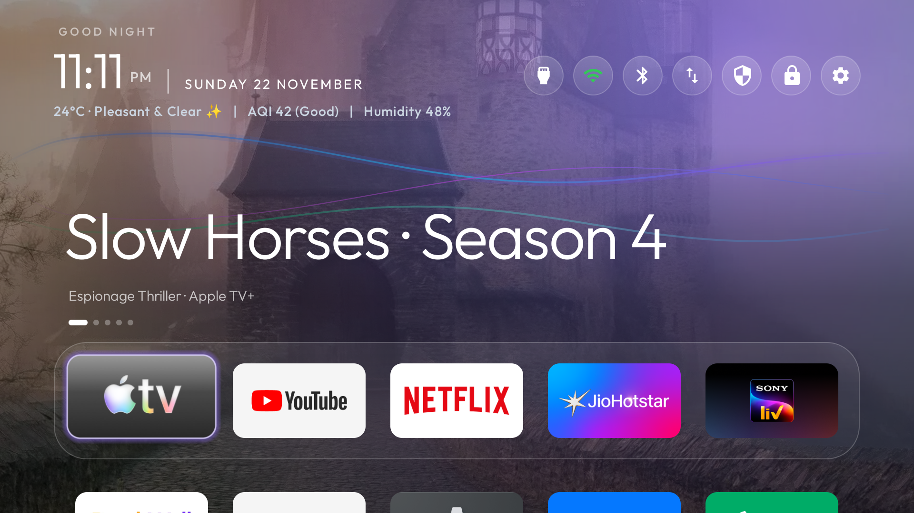
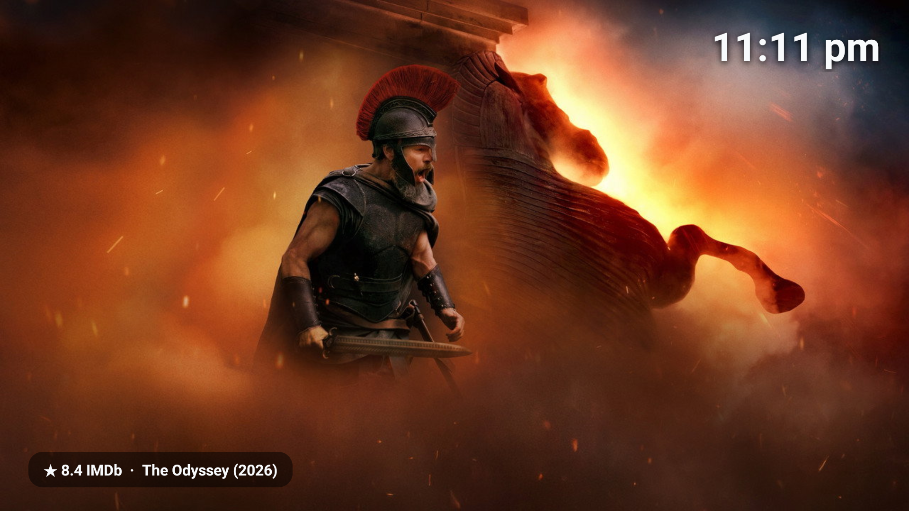
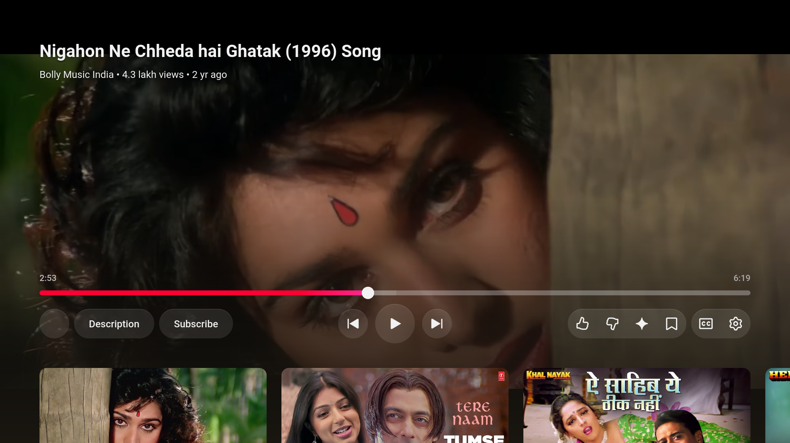
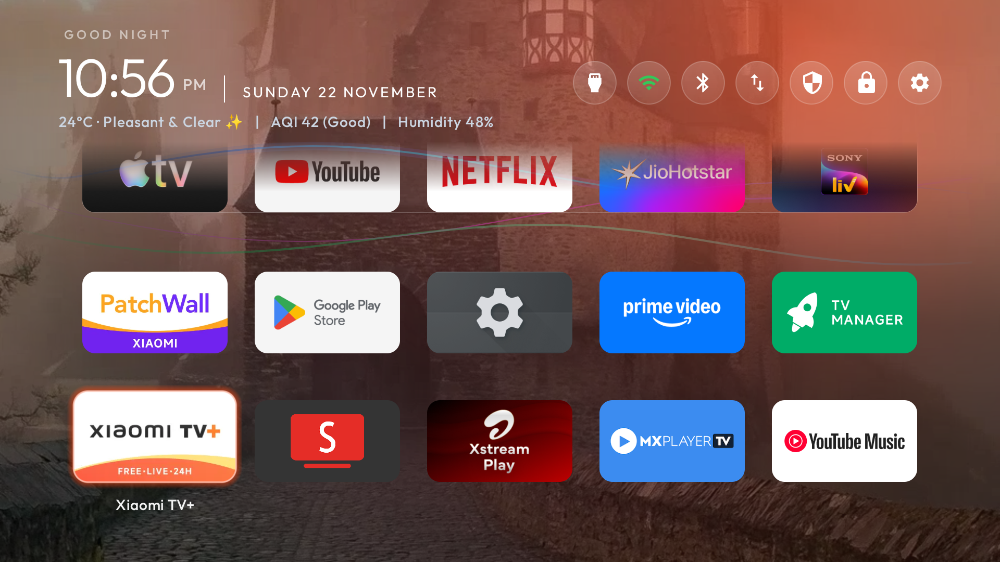

# 🍎 MI TV Launcher (Apple Style)

> Transform your Xiaomi Mi TV / Android TV into a fast, fluid, and elegant **Apple TV (tvOS)** inspired experience with daily live IMDb trending posters, dynamic 4K screensavers, built-in Control Center, and dedicated remote hotkey support.

[](https://developer.android.com/tv)
[](LICENSE)
[](releases/MiTvLauncherAppleStyle-v1.0.apk)
[](docs/INSTALLATION_GUIDE.pdf)

---

## 📸 Screenshots

| Apple TV Home Screen (IMDb Daily Backdrop) | Dynamic 4K Screensaver (Dual-Layer Crossfade) |
| :---: | :---: |
|  |  |

| YouTube Remote Integration | Classic Grid & App Launcher |
| :---: | :---: |
|  |  |

---

## ✨ Features

- **🍏 Apple TV (tvOS) Aesthetics**:
  - Sleek glassmorphism cards with smooth elevation and focus-scaling animations.
  - Ambient backdrop blurring and high-contrast typography designed for 10-foot TV viewing.
  - Zero bloatware, advertisements, or sponsored recommendations.

- **🎬 Live IMDb Movie & TV Show Sync (Open-Source Cinemeta API)**:
  - Powered by the open-source Stremio Cinemeta catalog.
  - Automatically fetches the top 12 trending movies and TV series daily in crystal-clear high resolution.
  - Automatically rotates your TV home wallpaper daily with the #1 trending title.

- **🌌 Dynamic 4K Dual-Layer Screensaver**:
  - Automatically activates during inactivity.
  - Seamless 14-second cross-fade animations between high-resolution IMDb backdrops and built-in 4K aerial videos.
  - Minimalist layout: Clean time display and subtle translucent IMDb title badge — zero intrusive captions or location text.

- **🔴 Dedicated YouTube Remote Button Fix (`TvKeyHandler`)**:
  - Full hardware interceptor for Xiaomi / PatchWall TV remotes.
  - Maps physical hotkeys (`KEYCODE_BUTTON_3` / `190`, `KEYCODE_YOUTUBE` / `288`, `KEYCODE_BUTTON_16` / `203`) directly to the official YouTube TV or SmartTube client.
  - Pressing the Home button instantly returns to the Apple Style home screen without latency.

- **🎛️ TV Control Center & Power Tools**:
  - **One-Click RAM Booster**: Cleans background tasks and frees up memory with visual feedback.
  - **Sleep Timer**: Easily toggle 15m, 30m, 60m, or 120m sleep timers.
  - **Quick Power Controls**: Instant Sleep, Restart, and Settings toggles from the home screen.

- **📱 Apple AirPlay & iPhone Screen Mirroring (Instant QR Code)**:
  - **Zero App Required on iPhone**: Connect effortlessly with any iPhone via the native Camera app.
  - **Instant QR Code**: Top status bar AirPlay icon (📺) launches a sharp QR code pointing to the TV's local Wi-Fi receiver (`http://<TV_IP>:7070`).
  - **Live Screen Mirroring**: Uses Safari Screen Broadcast (`getDisplayMedia`) to stream your iPhone screen at 30-60fps HD with low local Wi-Fi latency.
  - **4K Photo & Media Casting**: Select photos or videos from your iPhone Camera Roll to display in full-screen on your TV.
  - **Touch TV Remote**: Use your iPhone as a touch controller (D-Pad, Volume, Home, Back).

- **🔒 Child Lock & Privacy PIN**:
  - Built-in 4-digit PIN system to restrict access to selected apps and TV settings.

- **📺 Watch Next & Smart App Categories**:
  - Native Android TV `TvContract` integration to surface recently watched movies and episodes directly on the home shelf.
  - Automatic organization into Streaming, Media, Live TV, Tools, and Games.

---

## ⚡ Quick Start: 1-Click Installation

Connect your TV to the same Wi-Fi network and enable **ADB Debugging** under *Settings > Device Preferences > Developer Options*.

Run the automated installer script:

```bash
# 1. Connect to your TV via ADB
adb connect <YOUR_TV_IP_ADDRESS>:5555

# 2. Run the 1-click installer
./scripts/install.sh
```

The script will:
1. Install `MiTvLauncherAppleStyle-v1.0.apk`.
2. Grant `android.permission.WRITE_SECURE_SETTINGS` for system controls.
3. Enable and bind `HomeKeyService` for remote key intercepting.
4. Launch the launcher directly on your TV.

---

## 🛠️ Manual Installation & Setup

If you prefer installing manually via ADB:

```bash
# Install the signed APK
adb install -r releases/MiTvLauncherAppleStyle-v1.0.apk

# Grant system permissions for Control Center & Settings
adb shell "pm grant com.gathin.tvhome android.permission.WRITE_SECURE_SETTINGS"

# Enable Accessibility Service for remote hotkeys & Home key capture
adb shell "settings put secure enabled_accessibility_services com.gathin.tvhome/com.gathin.tvhome.HomeKeyService"
adb shell "settings put secure accessibility_enabled 1"

# Launch the app
adb shell "am start -n com.gathin.tvhome/.MainActivity"
```

### Making it Permanent (Default Launcher)
To make this launcher your permanent home screen and disable Xiaomi's stock PatchWall:

```bash
# Disable stock Xiaomi PatchWall launcher (can be re-enabled anytime)
adb shell "pm disable-user --user 0 com.mitv.tvhome"

# Optional: Disable Google Leanback Launcher if installed
adb shell "pm disable-user --user 0 com.google.android.tvlauncher"
```
*(To restore stock PatchWall at any time: `adb shell "pm enable com.mitv.tvhome"`)*

---

## 🏗️ Building From Source

### Prerequisites
- macOS or Linux
- `apktool` (`brew install apktool`)
- Android Build Tools (`apksigner`, `zipalign`)
- Java JDK 8+

### Build & Sign
```bash
./scripts/build.sh
```
This compiles the smali resources from `tvhome_src/`, packages the APK, and signs it using your debug keystore into `releases/MiTvLauncherAppleStyle-v1.0.apk`.

---

## 📂 Repository Structure

```text
├── README.md                      # Project overview and installation guide
├── AGENTS.md                      # Always-on instructions & constraints for agents
├── TODO.md                        # Task tracker, completed milestones & roadmap
├── .gitignore                     # Git ignore rules
├── docs/
│   ├── INSTALLATION_GUIDE.pdf     # Printable step-by-step installation manual (PDF)
│   ├── ARCHITECTURE.md            # System architecture, flows & component design
│   └── DECISIONS.md               # Architecture Decision Records (ADRs)
├── .agents/
│   └── skills/                    # Project-specific developer & agent workflows
│       ├── tv-deploy/             # Live TV ADB deployment & verification
│       └── apk-patch/             # Java-to-smali compilation & patching guide
├── releases/
│   └── MiTvLauncherAppleStyle-v1.0.apk # Pre-built, signed ready-to-flash APK
├── scripts/
│   ├── install.sh                 # 1-Click ADB installer & TV permission configurator
│   ├── build.sh                   # Apktool build and apksigner automation
│   └── generate_pdf.py            # Generates the printable PDF installation manual
├── screenshots/                   # Live screenshots captured from Xiaomi TV
│   ├── home_screen_imdb.png
│   ├── screensaver_imdb.png
│   ├── home_screen.png
│   └── yt_screen.png
├── src/com/gathin/tvhome/         # Custom Java sources
│   ├── AppleTvScreensaver.java     # Dual-layer crossfade 4K screensaver engine
│   ├── ImdbScreensaverManager.java # Stremio Cinemeta open-source daily sync
│   └── TvKeyHandler.java           # Remote hotkey interceptor for YouTube & Home
└── tvhome_src/                    # Complete decompiled smali & resource project
    ├── AndroidManifest.xml
    ├── assets/                    # Built-in 4K aerial video assets
    ├── res/                       # Apple glass drawables, layouts, and styles
    └── smali/                     # Modified bytecode & service handlers
```

---

## 📺 Compatibility

- **Xiaomi Mi TV**: 4A, 4X, 5X, 5A, Horizon Edition, Mi TV 4K
- **Streaming Devices**: Mi Box S / 4K, Mi TV Stick, Xiaomi TV Stick 4K
- **Any Android TV**: Running Android TV 9.0 (Pie), 10 (Q), 11 (R), or 12.

---

## 📄 License
Released under the [MIT License](LICENSE). Personal project customized for living room entertainment.
