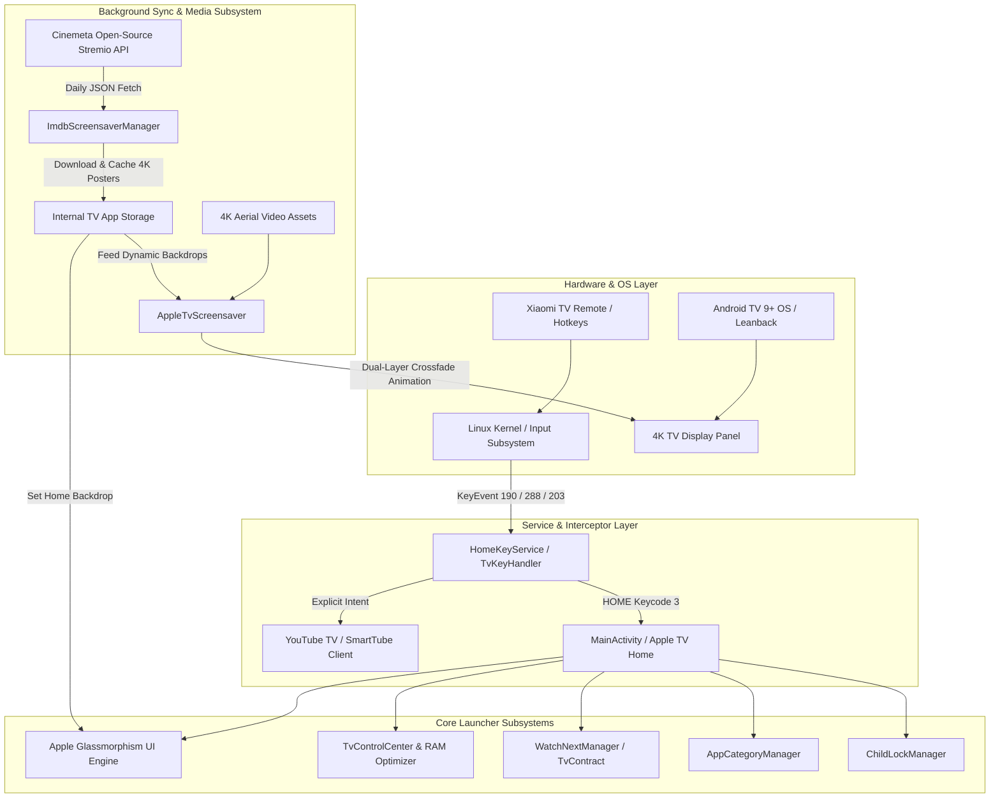

# 🏛️ System Architecture & Patterns

This document details the software architecture, runtime subsystems, and interaction flows for the **MI TV Launcher (Apple Style)** (`com.gathin.tvhome`).

---

## 📐 High-Level Architecture Diagram



---

## 🧩 Subsystem Details

### 1. Hardware Remote Key Interceptor (`TvKeyHandler` / `HomeKeyService`)
- **Key Interception**: Xiaomi TV remotes emit vendor-specific keycodes for dedicated buttons:
  - `KEYCODE_BUTTON_3` (Keycode 190)
  - `KEYCODE_YOUTUBE` (Keycode 288)
  - `KEYCODE_BUTTON_16` (Keycode 203)
- **Accessibility Routing**: When the physical key is pressed, `TvKeyHandler` detects the target code, checks package availability for `com.google.android.youtube.tv` (or `org.smarttube.stable`), and starts an explicit Activity Intent.
- **Return to Home**: The `HomeKeyService` accessibility service captures the standard `KEYCODE_HOME` (Keycode 3) event to smoothly navigate back to `com.gathin.tvhome/.MainActivity` without PatchWall latency.

---

### 2. Live IMDb Trending Sync (`ImdbScreensaverManager`)
- **API Architecture**: Uses the open-source Stremio Cinemeta catalog endpoint:
  ```text
  https://v3-cinemeta.strem.io/catalog/movie/top.json
  https://v3-cinemeta.strem.io/catalog/series/top.json
  ```
- **Sync Cadence**:
  - Automatically queries once every 24 hours.
  - Persists the top 12 movie/series backdrop URLs and metadata into internal JSON cache (`imdb_screensaver_cache.json`).
  - Downloads high-resolution 1080p/4K backdrop images into the app's cache directory.
- **Home Screen Integration**: The #1 trending title backdrop is dynamically set as the live home screen wallpaper backdrop with a subtle dark frost tint.

---

### 3. Dual-Layer 4K Screensaver Engine (`AppleTvScreensaver`)
- **Activity Lifecycle**: Triggered by user idle timeouts or manually from the Control Center.
- **Dual-Layer Crossfade**:
  - Uses two stacked `ImageView` / `TextureView` layers (`layerA` and `layerB`).
  - While `layerA` is visible with `alpha = 1.0`, `layerB` loads the next backdrop or video frame in the background.
  - Crossfades smoothly over 1.2 seconds using `ObjectAnimator` every 14 seconds.
- **Minimalist Overlay**:
  - Displays a clean, high-contrast clock (HH:mm) and a translucent frosted IMDb badge (title, release year, IMDb star rating).
  - Eliminates distracting location captions for a clean cinematic ambient display.

---

### 4. TV Control Center (`TvControlCenter`)
- Accessible via quick shortcut or navigation row.
- **RAM Cleaner**: Triggers `ActivityManager.killBackgroundProcesses()` to reclaim volatile memory and improve frame rates.
- **Sleep Timer**: Runs a scheduled `Handler` countdown to invoke `PowerManager.goToSleep()` or display sleep prompts after 15, 30, 60, or 120 minutes.
- **Child Lock PIN**: Implements a 4-digit PIN verification overlay guarding sensitive apps and launcher settings.

---

## 💾 Storage & Asset Layout

- `tvhome_src/assets/videos/`: Pre-bundled 4K aerial loop clips.
- `tvhome_src/assets/backdrops/`: High-resolution application backdrops.
- `/data/data/com.gathin.tvhome/cache/imdb/`: Dynamically downloaded daily trending posters and metadata.
